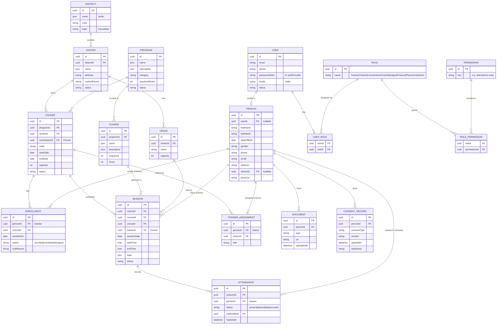

# MBV Platform — Phase 1 Data Model (ERD)

> Phase 1 = **Training Operations Core**. Status: DRAFT v0.1 (2026-06-04).
> Localized text fields (e.g. names/descriptions) are stored per-locale `{ en, kn }` for Kannada + English.
> Designed so LMS, Finance, and Placement modules attach cleanly in later phases.

---

## Entity-Relationship Diagram

---

## Notes & design choices

- **User vs Person:** `User` = login/credentials; `Person` = the human (trainee/trainer/staff). A trainee may exist as a `Person` *without* a `User` login (staff enter their data), and get a login later. Trainers/staff always have a `User`.
- **Roles:** RBAC via `Role` + `Permission` (many-to-many through join tables). One person can hold multiple roles (e.g. a Trainer who is also a Center Manager).
- **District as first-class:** enables **district-wise reporting** across ~30–60 centers — valued by donors/government.
- **Localized fields** (`name`, `description`, `topic`): stored as `{ en, kn }` JSON so both languages are first-class; extensible to more languages later.
- **Attendance** is the highest-frequency action — indexed on `(sessionId, personId)`; bulk-mark per session.
- **Consent records** capture DPDP consent at admission (adult trainees, 18+).
- **Audit log** (cross-cutting, not shown) records sensitive mutations: who/what/when.
- **Bulk import:** CSV import paths for `Person`, `District`/`Center`, and `Enrollment` to onboard the greenfield org quickly.

---

## Attachment points for later phases

| Future module | Attaches to |
|---------------|-------------|
| **LMS (Moodle)** | `Course` ↔ Moodle course; `Enrollment` ↔ Moodle enrolment; completion/certificate ↔ `Person` |
| **Finance** | `Expense` → `Program` / `Cohort` / `Center` |
| **Placement & M&E** | `Placement`, `EmployerPartner` → `Person`; outcome surveys → `Enrollment` |
| **Admissions** | `Application` → becomes `Person` + `Enrollment` on selection |
